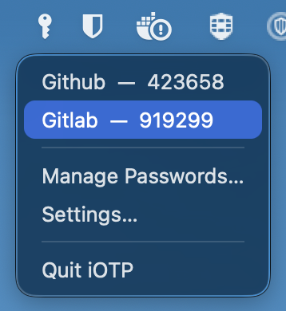
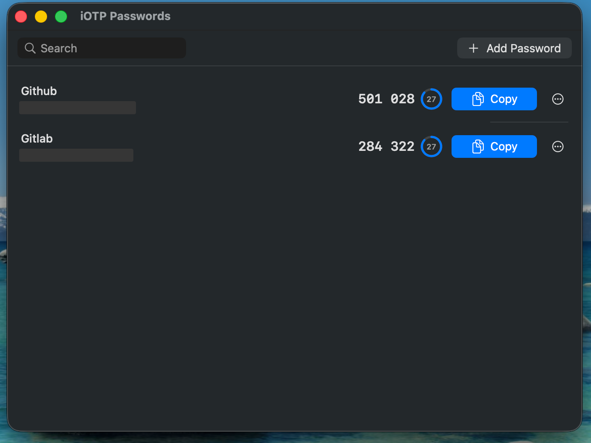
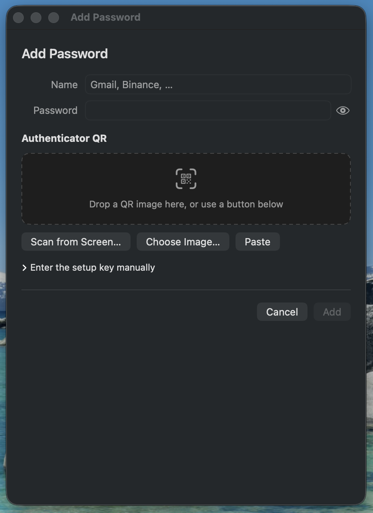
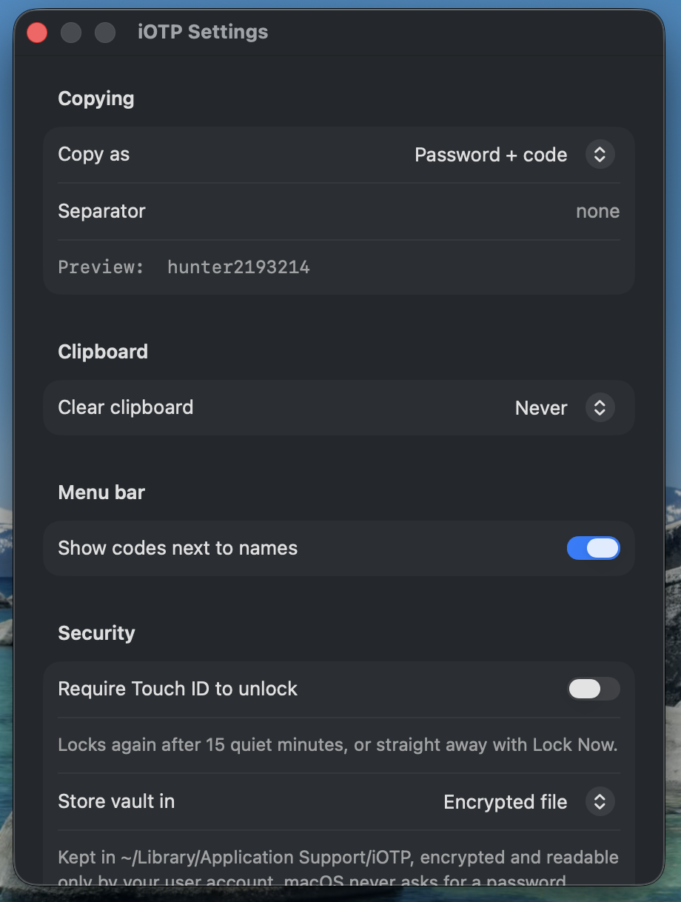

# iOTP

A small macOS menu-bar app that keeps your passwords together with their Google Authenticator
(TOTP) secrets. Click an entry in the menu and the password **with the current 6-digit code
appended** lands on your clipboard, ready to paste.

## Screenshots



Click the key icon next to the clock, click a name, and the password plus its current code is on
the clipboard.



**Manage Passwords** shows every entry with its live code and a ring counting down to the next one.



Adding an entry takes a name, a password, and the authenticator QR — dropped in, grabbed off the
screen, picked from a file, or pasted as an `otpauth://` link.



Settings decides what a copy contains, whether the clipboard is wiped afterwards, whether Touch ID
guards the vault, and where the vault is kept.

## Build and run

```bash
./build.sh              # builds dist/iOTP.app
./build.sh --install    # also copies it to /Applications and launches it
./test.sh               # RFC 6238 / base32 / otpauth / storage self-tests

# opens a window without clicking the status item, then prints what appeared
./dist/iOTP.app/Contents/MacOS/iOTP --open-window settings|manage|editor
```

A full Xcode installation is required to compile (the standalone Command Line Tools do not ship
the SwiftUI macro plugins). `build.sh` finds `/Applications/Xcode.app` on its own — you do not
need to run `xcode-select`.

The app has no Dock icon; it lives as a key icon in the menu bar next to the clock.

## Using it

Clicking the menu-bar key icon drops a plain macOS menu: one line per password, marked with a copy
glyph and reading `Name (123456)`. Click it to copy, then Manage Passwords / Settings / Quit.

**Manage Passwords** is the fuller view: live codes, a countdown ring per row, a Copy button,
search, edit and delete. Each row starts with a drag handle: pull it onto another row and the entry
takes that row's place. The row's menu also has **Move Up** / **Move Down** for one step at a time.
Both are held back while a search is filtering the list. Its **+** button (or ⌘N) is where passwords
are added.

That opens a fixed 470×620 window with three things:

1. **Name** — whatever you want to see in the menu.
2. **Password** — your fixed password.
3. **Authenticator QR** — feed it the QR in any of four ways:
   - drag a QR image or screenshot onto the dashed box,
   - **Scan from Screen** — drag a selection over a QR that is on screen right now
     (macOS asks for Screen Recording permission the first time),
   - **Choose Image** — pick a saved screenshot or photo of the QR,
   - **Paste** — an `otpauth://` link or a QR image already on the clipboard.

   There is also a disclosure row for typing the base32 setup key by hand, with algorithm,
   digit-count and period controls for the rare site that does not use the SHA1/6/30 default.

Google Authenticator's "Transfer accounts" export QR (`otpauth-migration://`) is understood too:
if it holds several accounts, a picker appears so you can attach the right one to this password.

## Settings (⌘,)

- **Copy as** — password + code (default), code + password, code only, or password only.
- **Separator** — optional text between the two parts; empty by default so the code is glued
  straight onto the password.
- **Clear clipboard** — optionally wipe the clipboard 15/30/60 seconds after a copy (it only
  clears if nothing else has copied something in the meantime).
- **Show codes next to names** — turn off if you would rather not display codes in the menu.
- **Require Touch ID to unlock** — optional app lock (falls back to the login password on Macs
  without a sensor).
- **Store vault in** — encrypted file (default, never prompts) or the login keychain.
- **Backup** — export the vault to a single passphrase-protected file, and restore it later.

## Where the data lives

By default everything (names, passwords, secrets) is one AES-GCM encrypted file:

```
~/Library/Application Support/iOTP/vault.dat   0600
~/Library/Application Support/iOTP/key.bin     0600
```

Nothing is written anywhere else and nothing leaves the machine. The honest description of this
protection: the encryption keeps your passwords out of backups, Spotlight and casual `grep`, while
what actually stops another person reading them is your macOS account and the `0600` file mode —
the key sits beside the vault.

**Why not the keychain by default?** The app is ad-hoc signed, so it has no stable code identity
and macOS cannot remember an "always allow" decision for it: every single read or write pops the
"enter your keychain password" dialog. The keychain is still offered in Settings for anyone who
signs the app with a real certificate; switching backends moves the vault across and deletes the
old copy.

For a stronger lock, turn on **Require Touch ID to unlock** in Settings: the vault stays locked
(entries are not even decrypted) until you authenticate, relocks after 15 quiet minutes, and the
menu gains a **Lock Now** item.

Every change is written as it happens, and the vault is written once more when the app quits (menu
Quit, logout, shutdown, or a plain `kill`). That last write is a safety net: if the vault file is
deleted while the app is open, quitting puts it back from memory. It is skipped when the vault is
locked or failed to load, so it can never replace real data with an empty list.

If storage ever fails, the manage window shows an orange banner and entries are kept in memory for
that session rather than being silently lost.

## Backups

Settings ▸ Backup writes the whole vault to one `.iotpbackup` file. It is deliberately **not**
sealed with the local `key.bin` — that key lives on the same disk as the vault, so a backup locked
with it would die with the machine. Instead you choose a passphrase, and the key is derived from it
with PBKDF2-HMAC-SHA256 (310,000 iterations, a fresh 16-byte salt per export) before AES-GCM seals
the contents. The envelope is readable JSON that names its own format, version, KDF and iteration
count, so a future version can still open it.

The passphrase is stored nowhere. Lose it and the backup is unopenable — keep it somewhere other
than the Mac you are backing up.

Restoring offers **merge** (entries are added, matching ones updated) or **replace** (the current
vault is discarded). Tampered files and wrong passphrases both fail closed: AES-GCM refuses to
return anything it cannot authenticate.

## Layout

```
Sources/iOTP/
  App.swift              @main: a plain AppKit entry point, no SwiftUI scenes
  AppDelegate.swift      status item, menu, windows, main menu
  EditorController.swift the entry the editor window is working on
  EntryEditorWindow.swift  add/edit window with the QR intake
  ContentView.swift      manage window: list, live codes, copy buttons
  SettingsView.swift
  Vault.swift            entry model, the store, lock state, clipboard handling
  VaultStorage.swift     encrypted-file and keychain backends
  BackupArchive.swift    passphrase-sealed backup format
  BackupSection.swift    the Backup block of the Settings window
  Reordering.swift       the index arithmetic behind drag-to-reorder
  BiometricLock.swift    Touch ID
  TOTP.swift             RFC 6238
  Base32.swift           RFC 4648
  OTPAuthURL.swift       otpauth:// and Google Authenticator export parsing
  QRScanner.swift        QR decoding from files, images, clipboard, screen selection
  Keychain.swift
  AppSettings.swift      UserDefaults keys
tools/MakeIcon.swift     generates the app icon at build time
tools/SelfTest/          the checks run by ./test.sh
```

## License

MIT — see [LICENSE](LICENSE).
